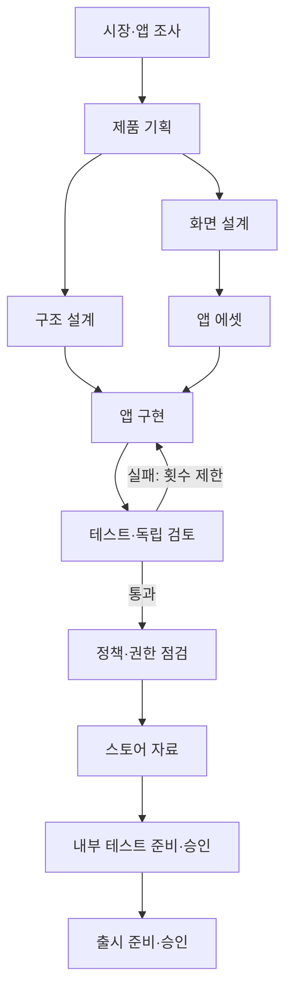

# Orca Toris Neon

**앱 제작, 독립 검토, Play Store 점검, 어제 작업 이어하기를 하나의 Orca 패널에서.**

Toris Neon은 [Orca](https://orca.dev/)의 네이티브 HTML 패널과 Node 워커로 동작하는 개발 플러그인입니다. 앱 목표를 의존성 그래프로 나누고, 단계별 작업자와 검토자를 배정합니다. 테스트 실패는 구현 단계로 되돌리고, 작업 결과와 검증 자료를 저장해 다음 날 이어갈 수 있게 합니다.

[herdr-toris-neon](https://github.com/torisKR/herdr-toris-neon)의 Auto App, Play Check, Today에서 출발해 Orca의 프로젝트·작업 공간·에이전트 API에 맞게 구현했습니다.

| 항목 | 값 |
|---|---|
| 플러그인 ID | `toris-neon` |
| 저장소 | [torisKR/orca-toris-neon](https://github.com/torisKR/orca-toris-neon) |
| 버전 | `0.1.0` |
| Orca | `>=1.4.260`, 데스크톱 플러그인 호스트 |
| 개발·테스트 | Node.js `>=22`, Git |
| 구성 | JavaScript ES modules, HTML, CSS · 추가 런타임 패키지 의존성 없음 |
| 라이선스 | [MIT](LICENSE) |

## 네 가지 화면

| 화면 | 하는 일 |
|---|---|
| **Auto App** | 앱 목표로 실행 계획 생성, 의존성 그래프, 작업자·검토자 배정, 수정 루프, 단계 승인 |
| **Play Store** | 여러 서비스 계정의 앱·트랙별 출시 상태 조회, 실패한 조회의 이전 관측값과 시각 보존 |
| **오늘 이어하기** | 한국 시간 기준 오늘·어제의 실행 기록, 인계 메모, 기존 작업 일지, 검증 신선도, 이전 세션 이어하기 |
| **Agents** | Orca 에이전트 상태와 플러그인이 배정한 작업을 확인하고 해당 터미널 열기 |

## 설치

Orca를 실행한 상태에서 다음 명령을 사용합니다.

```sh
orca plugin install torisKR/orca-toris-neon@v0.1.0 --json
```

이 플러그인은 코드를 실행하므로 Orca가 `approval_required`와 함께 게시자, 저장소, 요청 권한, 파일 지문 및 재실행 명령을 보여 줍니다. 내용을 확인한 뒤 **그 응답이 반환한 정확한 승인 명령**을 실행하세요.

```sh
orca plugin install torisKR/orca-toris-neon@v0.1.0 --approve <반환된-fingerprint> --json
```

승인 지문은 해당 플러그인·버전·파일·권한 범위에 묶입니다. 다른 버전의 지문을 재사용하지 않습니다. 설치 결과 또는 아래 목록에서 정확한 플러그인 키를 확인한 뒤 패널을 엽니다.

```sh
orca plugin list --json
orca plugin open <plugin-key> --panel studio --json
```

Orca의 Settings → Plugins에서도 활성화 상태를 확인할 수 있습니다. 패널은 오른쪽 사이드바에 나타납니다.

**Linux:** 설치 방식에 따라 Orca IDE 명령은 `orca-ide`입니다. `orca`가 GNOME 화면 읽기 프로그램을 가리키는 환경에서는 위 명령의 실행 파일을 `orca-ide`로 바꾸세요. 현재 설치본의 `--help`와 Orca에 포함된 가이드를 기준으로 사용합니다.

### 개발 폴더로 로드

```sh
git clone https://github.com/torisKR/orca-toris-neon.git ~/projects/orca-toris-neon
cd ~/projects/orca-toris-neon
npm test
npm run check
orca plugin validate . --json
orca plugin dev load . --json
```

개발 로드에서도 Orca가 반환한 지문으로 승인합니다. 승인된 개발 폴더의 코드 변경은 자동으로 다시 로드될 수 있습니다. 개발 폴더에 대한 승인은 이후 코드 변경도 실행할 수 있는 신뢰를 포함하므로, 변경한 내용을 확인하면서 사용하세요. 새 권한이 추가되면 Orca의 새 승인을 따릅니다.

## Auto App 사용

1. Orca에 **로컬 Git 프로젝트**를 등록하고 최소 한 번 커밋합니다. 에이전트가 사용할 CLI·로그인·SDK·빌드 도구도 준비합니다.
2. Auto App에서 프로젝트와 앱 목표를 선택합니다. 기본은 별도 작업 공간을 만들며, 기존 작업 공간을 선택할 수도 있습니다.
3. 각 단계의 **작업자와 검토자**를 배정합니다. Codex, Claude, Cursor, Grok, Antigravity, Gemini, OpenCode, Kiro 등 현재 Orca에서 사용할 수 있는 도구를 선택합니다.
4. 계획을 만든 뒤 **시작**합니다. 계획 생성만으로 에이전트가 실행되지는 않습니다.
5. 그래프와 결과를 확인합니다. 검토가 통과한 단계의 다음 작업만 배정되며, 테스트 실패는 구현 단계로 돌아갑니다.
6. 내부 테스트·출시 단계에서는 준비 결과를 확인하고 실행 범위를 승인합니다.

기본 그래프는 다음과 같습니다.



저장된 의존성 그래프 자체는 순환이 없는 DAG입니다. 그림의 실패 경로는 별도의 횟수 제한이 있는 재작업 전이입니다. 각 단계에는 작업 이후의 별도 검토 세션이 있습니다.

### 여러 에이전트와 반복 작업

실행 하나의 기본 동시 배정 수는 **2개**, 설정 가능한 범위는 **1–6개**입니다. 서로 의존하지 않는 조사·설계·검토는 함께 진행할 수 있습니다. 같은 작업 공간을 사용하는 소스 변경 단계는 다른 작업이 끝난 뒤 단독으로 실행해 수정 충돌과 검토 중 코드 변경을 줄입니다. 여러 실행이 같은 공간을 선택했을 때도 활성 배정이 서로 겹치지 않도록 보류합니다. 별도 작업 공간의 실행에는 각각의 상한이 적용됩니다.

검토자는 작업자와 **별도 세션**입니다. 같은 공급자의 에이전트를 작업자·검토자로 배정할 수 있습니다. 이 버전은 단계별 공급자 배정을 지원하며, Orca 플러그인 API가 제공하지 않는 단계별 모델·추론 강도 설정은 추가하지 않았습니다. 모델 설정은 Orca의 해당 에이전트 설정을 따릅니다.

기본값은 `maxAttempts=3`, `maxRepairLoops=3`입니다. 단계별 시도 횟수와 QA 수정 루프 한도를 모두 적용하므로 **먼저 도달한 한도에서 멈춥니다**. 예를 들어 처음 구현·테스트가 이미 한 번 실행됐다면, 단계별 3회 한도 때문에 추가 수정·테스트를 무조건 세 번 더 실행하는 것은 아닙니다.

### 터미널에 첫 지시가 전달되지 않은 경우

터미널은 열렸지만 입력 화면이 비어 있고 작업이 시작되지 않았다면, 해당 터미널을 직접 확인한 뒤 단계 화면의 확인란을 선택하고 **기존 터미널에 지시 전달**을 누를 수 있습니다. 복구 가능한 차단 상태에서만 제공되며, 기존 터미널을 열고 포커스를 확인한 뒤 같은 배정의 지시를 한 번 전달합니다. 포커스에 실패하면 지시를 보내지 않고 한 번의 복구 기회도 사용하지 않습니다.

자동 재전송이나 새 에이전트 생성은 하지 않습니다. 전달 결과가 불명확하면 다시 막고, 일시정지한 실행은 별도로 재개해야 합니다. [적용 조건과 중복 방지 계약](docs/ARCHITECTURE.md#첫-지시-전달-복구)을 참고하세요.

### 완료와 출시의 의미

에이전트 터미널이 종료되거나 `done`이 되어도 단계를 자동으로 통과시키지 않습니다. 현재 배정과 일치하는 결과 JSON, 실제 파일 근거, 독립 검토 결과가 필요합니다. 실패·미확인·권한 대기를 성공으로 바꾸지 않습니다.

내부 테스트와 출시 단계의 기본 동작은 **준비·검토**입니다. 실제 제출을 원하면 패키지명, 트랙, versionCode와 승인 메모를 지정해야 합니다. 승인은 현재 소스 지문에 묶이며, 이후 소스가 변경되면 제출을 중단합니다.

실제 제출은 배정된 에이전트가 **그 앱 저장소에 이미 구성된 출시 도구와 자격 증명**을 사용합니다. 플러그인 자체에 새 Android Publisher 업로더를 넣지는 않았습니다. 도구·권한·검증 근거가 없거나 제출 응답이 불명확하면 확인이 필요한 상태로 남깁니다. 자세한 계약은 [설계 문서](docs/ARCHITECTURE.md#실제-제출-승인)를 참고하세요.

## Play Store 점검

Play Store 화면에서 계정 이름과 서비스 계정 JSON을 등록합니다. 선택적으로 로컬 키 파일 경로도 사용할 수 있습니다. JSON은 Orca의 **OS 키링으로 보호되는 비밀 저장소**에 보관하며, 일반 설정이나 화면 응답에는 키·이메일·토큰·파일 경로를 넣지 않습니다. 키링 보호가 불가능한 환경에서는 등록을 거부합니다.

패키지 목록이 비어 있으면 접근 가능한 앱을 자동 조회합니다. 목록을 입력하면 그 패키지만 확인하며, 트랙은 기본 `production`, `beta`, `alpha`, `internal` 외에 직접 지정할 수 있습니다.

출시 상태 조회는 Google 공식 **GET API**를 사용합니다. Play Check는 edit 생성, 업로드, 승격을 수행하지 않습니다. 인증 토큰 발급에만 POST를 사용합니다. 조회 실패 시 이전 데이터를 지우지 않고 **이전 관측 시각·오래된 결과 표시·실패 이유**를 함께 보여 줍니다.

[계정 설정, 상태 해석, 캐시와 제한 →](docs/PLAY_STORE.md)

## 오늘 이어하기

작업을 마칠 때 진행 내용, 다음 행동, 중단 사유, 보류한 결정, 실제 수행한 검증을 인계 메모로 저장합니다. 다음 날에는 한국 시간(`Asia/Seoul`) 기준으로 어제의 실행 이벤트와 메모를 확인하고 이어갈 수 있습니다. 완료·취소한 실행을 보관해도 원래 이력과 결과 파일 참조가 남습니다.

검증 신선도는 커밋, 추적 파일의 실제 변경, 미추적 파일 내용을 바탕으로 판단합니다. 글자 수가 같아도 내용이 바뀌면 이전 검증을 그대로 신뢰하지 않습니다. 검증할 수 없는 경우는 `unknown`입니다.

기존 `~/projects/toris-docs/journal/dev/<project>/YYYY-MM-DD.md`가 있으면 오늘·어제 일지를 읽습니다. 경로는 플러그인 설정의 `worklogRoot`에서 변경할 수 있습니다. 원본 일지를 수정하거나 프로젝트 저장소에 작업 일지를 만들지 않습니다.

[날짜 처리, 세션 재개, 기록 저장 위치 →](docs/RESUME.md)

## 권한과 실행 경계

Toris Neon은 `execution: "trusted-worker"`인 **신뢰된 Node 워커**입니다. 해당 프로세스의 Node 파일 시스템·네트워크 접근은 샌드박스로 제한되지 않습니다. 아래 capability는 Orca 호스트 API의 권한 범위이며, Node 프로세스 전체를 격리한다는 뜻은 아닙니다.

| 선언 권한 | 용도 |
|---|---|
| `workspace:read` | 프로젝트·작업 공간·현재 컨텍스트 확인 |
| `workspace:create` | 실행용 작업 공간 생성 |
| `workspace:write` | 작업 공간 열기 등 작업 공간 제어 |
| `agent:read`, `agent:launch` | 상태 확인, 단계별 작업자·검토자 시작, 이어하기 |
| `terminal:read`, `terminal:send` | 배정한 터미널 확인·포커스·취소 시 종료 |
| `history:read` | 선택한 작업 공간의 이전 에이전트 세션 확인 |
| `storage:own` | 실행 상태, 조회 캐시, 인계 메모 |
| `secrets:own` | 플러그인 전용 Play 서비스 계정 저장 |
| `settings:own` | 작업 일지 경로와 플러그인 설정 |
| `notifications:show` | 플러그인 상태·확인 요청에 사용하는 선언 권한 |

코드가 직접 다루는 로컬 파일은 실행 결과 디렉터리, 선택한 프로젝트의 검증 대상, 사용자가 지정한 서비스 계정 파일, 지정한 작업 일지입니다. 저장 위치와 호스트 API 계약은 [ARCHITECTURE.md](docs/ARCHITECTURE.md)에 정리했습니다.

## 개발과 검증

```sh
npm test
npm run check
orca plugin validate . --json
orca plugin test . --json
orca plugin check . --json
```

- `npm test`: 그래프 전이, 재시도·중복 실행 방지, 결과 검증, Play API 모의 응답, 날짜·소스 신선도·이어하기 테스트.
- `npm run check`: 저장소의 정적 검사.
- `orca plugin validate`: 실제 Orca 규격에 대한 manifest·호스트 API 검사.
- `orca plugin test`, `orca plugin check`: 현재 Orca 빌드의 검사 도구. 이 명령들은 검사 코드를 로컬에서 샌드박스 없이 실행할 수 있으므로 신뢰하는 코드에 사용합니다.
- HTML 패널의 배치·입력·실제 호스트 연결은 Orca에 로드해 별도로 확인합니다. `plugin check`만으로 HTML 화면의 모든 사용자 흐름을 검증했다고 간주하지 않습니다.

테스트는 실제 앱의 전체 생성·기기 설치·스토어 업로드를 수행하지 않습니다. 각 앱의 SDK, 실제 디바이스, 서비스 계정 권한, 출시 도구를 갖춘 별도 실행에서 확인해야 합니다.

### 화면 개발 미리보기

```sh
npm run preview -- --start
```

출력된 로컬 URL에서 샘플 데이터로 화면과 입력 흐름을 확인할 수 있습니다. 이 개발 서버는 실제 Orca 에이전트나 Google API를 실행하지 않으며, 서비스 계정 키 저장을 거부합니다. 화면에 미리보기 표시가 있고 서버는 30분 후 종료됩니다. 실제 호스트 연결은 개발 플러그인을 로드한 Orca 패널에서 확인합니다.

### 현재 범위

- Auto App의 완료 파일 검증은 **로컬 Git 작업 공간**을 지원합니다. 원격 작업 공간은 현재 이 실행 경로에서 거부합니다.
- 진행 기록은 해당 Orca 호스트에 저장됩니다. Mac과 Windows 사이의 자동 동기화나 코드 이전 기능은 없습니다.
- 앱 수익·설치 수·리뷰 통계, 별도의 백엔드 서비스, 강제 퍼미션 우회는 포함하지 않습니다.
- 일반적인 `runtime_timeout`이면 먼저 `orca status --json`을 확인하세요. 실행 중 작업을 보존하고 데스크톱 앱의 업데이트·재시작 상태를 확인한 뒤 사용자가 안전하게 닫고 다시 엽니다. 활성 에이전트를 무차별 종료하거나 Orca 상태 파일을 직접 고치지 마세요.
- 창이 없는 headless 런타임에서는 플러그인 패널이나 플러그인 서비스를 제공하지 않을 수 있습니다. 실제 데스크톱 호스트에서 지원 여부를 확인하세요.

## 구조와 기여

| 경로 | 책임 |
|---|---|
| `orca-plugin.json` | Orca 규격, 권한, 패널·명령 기여 |
| `src/worker.mjs` | 플러그인 수명 주기와 패널 요청 연결 |
| `src/engine.mjs` | 순수한 그래프 상태 전이 |
| `src/runtime.mjs` | 실제 Orca 작업 공간·에이전트·결과 검증 |
| `src/play.mjs` | 보호된 계정 저장과 읽기 전용 Play 조회 |
| `src/today.mjs` | 한국 시간 일지·인계·검증 신선도·세션 재개 |
| `panel/` | 네이티브 HTML 패널 |
| `tests/` | 네트워크·호스트를 주입하는 결정적 테스트 |

변경 시 해당 기능의 테스트와 문서를 함께 갱신해 주세요. 신규 외부 동작은 결과를 확인할 수 있는 근거, 중복 실행 방지, 실패 시 상태 보존을 포함해야 합니다. 비밀키·로컬 실행 기록·사용자 프로젝트 내용을 PR에 넣지 않습니다.

설계 배경: [ARCHITECTURE.md](docs/ARCHITECTURE.md) · Play: [PLAY_STORE.md](docs/PLAY_STORE.md) · 이어하기: [RESUME.md](docs/RESUME.md)

## 참고

- [Orca 공식 저장소](https://github.com/stablyai/orca)
- [Orca 플러그인 제작 가이드](https://github.com/stablyai/orca/blob/main/skill-guides/orca-plugin-authoring.md) · 실행 환경의 정확한 계약은 설치본의 `orca skills get orca-plugin-authoring`
- [Herdr Toris Neon](https://github.com/torisKR/herdr-toris-neon)
- [Google Play release lifecycle 조회 API](https://developers.google.com/android-publisher/api-ref/rest/v3/applications.tracks.releases/list)
